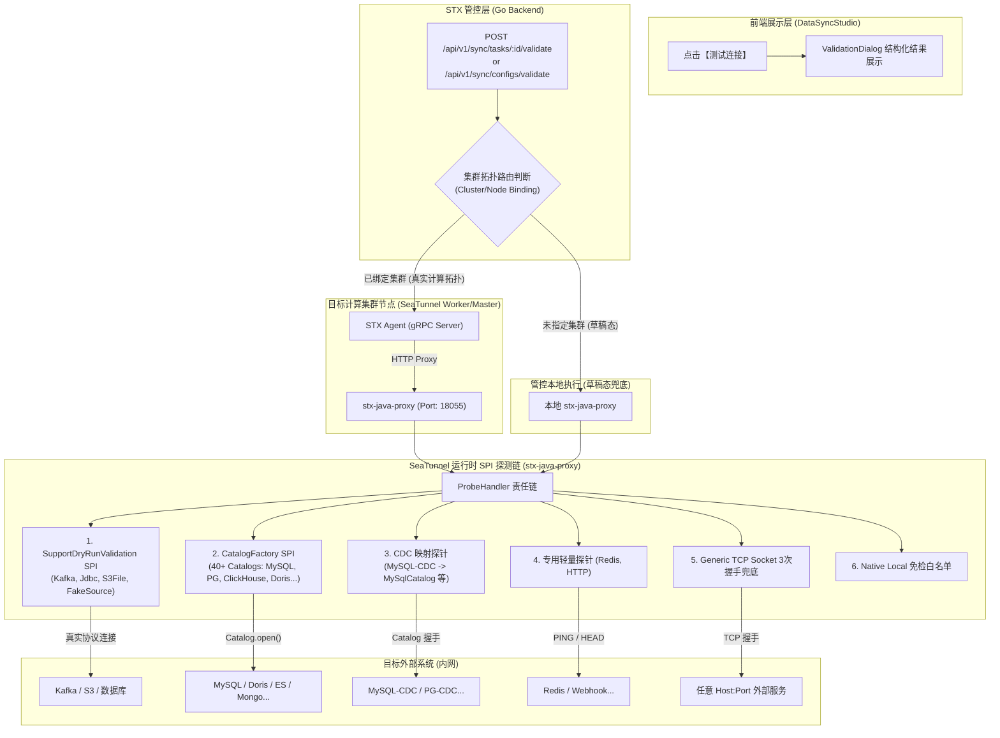
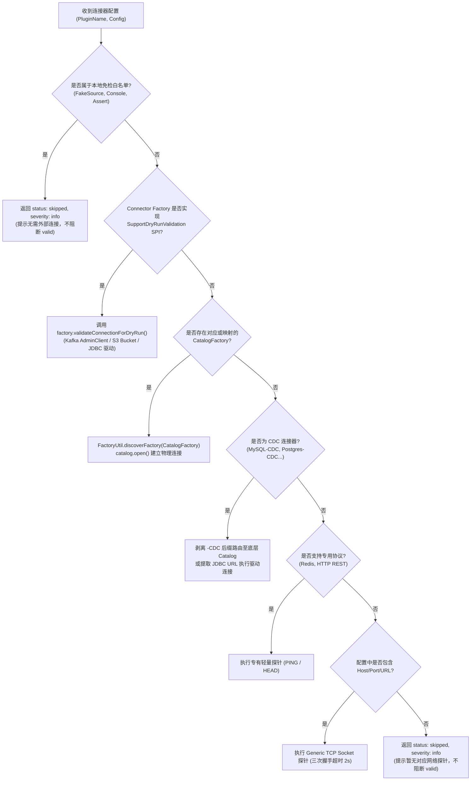

# 架构设计: 基于 SeaTunnel SPI 与集群拓扑感知的全量连接器测试连接体系

## 1. 架构总览

本设计构建了一个从 **Web 控制台 -> 后端调度路由 -> 集群节点 Agent -> 引擎 Java Proxy -> SeaTunnel SPI 探测** 的端到端闭环体系：



---

## 2. Java Proxy 核心设计：SPI 探测责任链 (Probe Chain)

在 `stx-java-proxy` 中，摒弃过去的单个 `if (!"Jdbc".equalsIgnoreCase(pluginName))` 硬编码，改为标准的**可插拔责任链（Chain of Responsibility）**设计：



### 2.1 SeaTunnel 源码契约映射表

根据我们对 SeaTunnel v3.0.0 源码 80+ 个连接器模块的实际扫描，探测机制映射如下：

| 连接器类别 | 包含插件 | 探测技术方案 |
| :--- | :--- | :--- |
| **官方 DryRun SPI** | `Kafka`, `Jdbc`, `S3File`, `FakeSource` | `SupportSourceDryRunValidation.validateConnectionForDryRun()`<br/>`SupportSinkDryRunValidation.validateConnectionForDryRun()` |
| **关系型与分析型 (Catalog 覆盖)** | `MySQL`, `PostgreSQL`, `Oracle`, `SQLServer`, `ClickHouse`, `Doris`, `StarRocks`, `Databend`, `DB2`, `Dameng`, `Kingbase`, `OpenGauss`, `TiDB`, `OceanBase`, `Redshift`, `SapHana`, `DuckDB`, `HighGo`, `Iris`, `Xugu`, `YashanDb` (共 21 种) | `FactoryUtil.discoverOptionalFactory(classLoader, CatalogFactory.class, identifier)`<br/>调用 `catalogFactory.createCatalog().open()` |
| **CDC 族 (官方 Catalog 映射)** | `MySQL-CDC`, `Postgres-CDC`, `Oracle-CDC`, `SqlServer-CDC`, `TiDB-CDC` | 遵循 SeaTunnel `CatalogTableUtil.getCatalogTables` 官方规范：<br/>`factoryId = pluginName.replace("-CDC", "")`<br/>调用底层对应数据库 Catalog 建立连接并探测 |
| **数据湖与对象存储 (Catalog 覆盖)** | `Iceberg`, `Hudi`, `Paimon`, `Kudu`, `MaxCompute`, `S3File`, `OssFile`, `HdfsFile`, `GcsFile` | 动态加载对应 `CatalogFactory` 执行探测 |
| **搜索引擎与 NoSQL (Catalog 覆盖)** | `Elasticsearch`, `Easysearch`, `MongoDB`, `Milvus`, `Typesense`, `Hbase` | 动态加载对应 `CatalogFactory` 执行探测 |
| **专用网络探针** | `Redis` (RESP PING), `Http` (HTTP GET/HEAD) | 专用轻量探针 |
| **通用 TCP 兜底** | 任何包含 `host` / `hostname` / `port` 或 `url` 的第三方外部连接器 | `Socket.connect(new InetSocketAddress(host, port), 2000)` |
| **本地免检组件** | `FakeSource`, `Console`, `Assert`, `LocalFile` | 声明为无需外部连接，返回 `skipped` + `severity: info` |

---

## 3. 集群拓扑路由与调度设计 (STX Agent Router)

### 3.1 为什么必须经过 Agent？
若 STX 仅在自己所在的服务器上执行探测，无法真实反映计算集群的网络环境。

### 3.2 路由分发逻辑 (Go 后端)

```go
// internal/apps/sync/service.go
func (s *SyncService) ValidateTaskConnection(ctx context.Context, taskID uint, req *ValidateRequest) (*ValidationResult, error) {
    task, err := s.getTask(taskID)
    if err != nil {
        return nil, err
    }
    
    // 1. 获取任务绑定的目标集群与节点
    clusterID := task.TargetClusterID
    if clusterID > 0 {
        activeNode, err := s.clusterService.GetActiveExecutionNode(clusterID)
        if err == nil && activeNode != nil {
            // 2. 路由到集群节点的 Agent 执行
            return s.agentClient.ValidateConfigOnNode(ctx, activeNode.AgentID, req)
        }
    }
    
    // 3. 兜底：未绑定集群或 Agent 离线时，使用本地 Java Proxy 执行
    return s.javaProxyClient.ValidateConfig(ctx, req)
}
```

---

## 4. 三态判定模型与 API 响应协议

### 4.1 Java Proxy 响应体契约升级

```json
{
  "ok": true,
  "valid": true,
  "probed_by": {
    "execution_target": "agent-worker-01",
    "host": "10.0.0.211",
    "engine_version": "3.0.0"
  },
  "checks": [
    {
      "nodeId": "source-0",
      "kind": "source",
      "connectorType": "Source[0]-MySQL-CDC",
      "target": "127.0.0.1:3306",
      "status": "success",
      "probeMethod": "catalog-mysql",
      "latencyMs": 15,
      "message": "Connection and metadata probed successfully via MySqlCatalog."
    },
    {
      "nodeId": "sink-0",
      "kind": "sink",
      "connectorType": "Sink[0]-Console",
      "target": "",
      "status": "skipped",
      "severity": "info",
      "probeMethod": "native-local",
      "latencyMs": 0,
      "message": "该连接器不依赖外部服务，无需连接测试。"
    }
  ],
  "errors": [],
  "warnings": [],
  "infos": [
    "Sink[0]-Console 无需连接测试: 该连接器不依赖外部服务，无需连接测试。"
  ],
  "summary": "Config validation and connection test passed."
}
```

### 4.2 核心规则判定代码修正
在 `ConfigValidationService.java` 中：
```java
// 严禁将 skipped 计入 allChecksSucceeded 失败！
if ("failed".equals(status)) {
    errors.add(String.format("%s 连接失败: %s", check.get("connectorType"), check.get("message")));
    allChecksSucceeded = false;
} else if ("skipped".equals(status)) {
    // 无论是本地免检还是平台能力兜底，均为 info，绝不阻断验证
    infos.add(String.format("%s 连接状态: %s", check.get("connectorType"), check.get("message")));
}
// 最终判断：只有真正发生错误时 valid 才为 false
boolean passed = errors.isEmpty();
```

---

## 5. 安全与稳健性保障

1. **类加载器安全**：必须使用 SeaTunnel 专用的 `PluginClassLoader`，并在探测结束后的 `finally` 块中严格还原 `Thread.currentThread().setContextClassLoader(originalClassLoader)`。
2. **连接超时熔断**：每个探测分支设置严格的 Socket / JDBC Connect Timeout（默认 2000ms），总探测设有 `Future.get(5000, TimeUnit.MILLISECONDS)` 超时熔断保护，防止目标 IP 无响应卡死线程。
3. **敏感凭证脱敏**：返回给前端的报错信息统一经过 `DryRunConnectFailureMessageSanitizer` 脱敏，确保不会出现明文数据库密码。
