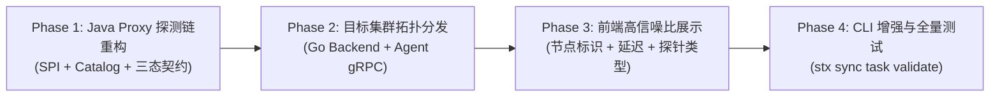

# 实施方案: 基于 SeaTunnel SPI 与集群拓扑感知的全量连接器测试连接体系

## 1. 实施阶段规划 (Phases)

整个实施拆分为四个递进阶段，每个阶段均具备自闭环的验证门控与可测试性：

---

### Phase 1: Java Proxy 探测链重构 (核心引擎层)

**目标**：彻底淘汰原有的单点 `if (!"Jdbc".equalsIgnoreCase(pluginName))` 硬编码，构建标准的 SPI / Catalog 探测责任链，修正三态判定契约。

1. **新建探测处理器契约与责任链 (`tools/stx-java-proxy`)**：
   - `ConnectorProbeHandler` 统一接口：
     - `boolean supports(String pluginName, Config config)`
     - `ProbeResult probe(ProxyNode node, Config config, ClassLoader classLoader)`
   - 实现以下具体 Handler：
     - `DryRunValidationProbeHandler`：适配实现 `SupportSourceDryRunValidation` / `SupportSinkDryRunValidation` 的官方插件（如 `Kafka`, `Jdbc`, `S3File`）；
     - `CatalogFactoryProbeHandler`：通过 `FactoryUtil.discoverOptionalFactory(CatalogFactory.class)` 动态加载 40+ 官方 Catalog 并执行 `open()` 测试；
     - `CdcCatalogMappingProbeHandler`：遵循 `CatalogTableUtil` 规范，对 `MySQL-CDC`, `Postgres-CDC`, `Oracle-CDC`, `SqlServer-CDC` 剥离 `-CDC` 路由到底层 DB Catalog；
     - `SpecialProtocolProbeHandler`：对 Redis 执行 `PING`，对 Http 执行轻量请求；
     - `GenericTcpProbeHandler`：对包含 host:port 的外部配置执行 Socket 三次握手兜底；
     - `NativeLocalProbeHandler`：对 `FakeSource`, `Console`, `Assert`, `LocalFile` 标记免检。

2. **三态判定与契约修正 (`ConfigValidationService.java`)**：
   - 彻底废除 `severity: "warning"` 导致 `allChecksSucceeded = false` 的误判逻辑；
   - 修正判定规则：只要未出现 `status: "failed"`，整体即为 `valid: true`；
   - `skipped` 节点作为 `info` 传递，前端显示中立说明，不标黄或标红。

---

### Phase 2: 目标集群拓扑分发 (分布式调度层)

**目标**：消除 Web 管控节点与计算集群节点的网络隔离假象，支持向指定的集群 Agent 分发探测任务。

1. **Agent gRPC 接口适配 (`agent/proto/agent.proto` & `agent/internal`)**：
   - 确认 Agent 已有的 `ValidateConfig` 或代理转发能力，支持携带 `test_connection=true`；
   - Agent 接收到请求后，直接调用本节点运行的 `stx-java-proxy`（端口 18055）执行探测。

2. **Go 后端路由增强 (`internal/apps/sync/service.go`)**：
   - 在任务校验接口 `ValidateTask(taskID)` 中，提取任务关联的 `TargetClusterID`；
   - 若关联了活跃集群，优先调度给集群健康节点上的 Agent；
   - 若未关联集群或为临时草稿，降级为管控端本地的 `stx-java-proxy` 执行；
   - 在返回的校验结果中注入 `probed_by` 元数据（节点名称、主机 IP、执行模式）。

---

### Phase 3: 前端高信噪比展示 (UI/UX 交互层)

**目标**：遵循 `.trellis/spec/frontend/ui-conventions.md` 规范，实现高信噪比、渐进式披露的测试连接结果呈现。

1. **弹窗结构升级 (`ValidationDialog.tsx` & `DataSyncStudio.tsx`)**：
   - 顶部元数据条带：高亮展示当前探测是由哪个集群节点执行的（如 `探测环境: 集群生产主节点 (10.0.0.211)`）；
   - 列表项原子信息：展示连接器名称、目标地址、探测耗时（如 `12ms`）、探测方式（如 `Catalog 深度验证` / `TCP 网络可达`）；
   - 状态色彩规范：
     - `success` -> 绿色盾牌/勾选；
     - `skipped` -> 灰色中立圆圈（文案：本地免检 / 网络已打通）；
     - `failed` -> 红色叹号（清晰展示脱敏后的失败根因）。

---

### Phase 4: CLI 增强与全链路验证 (CLI 与回归测试)

1. **CLI 命令支持 (`internal/apps/sync/task_cli.go`)**：
   - 扩展 `stx sync task validate <id> --test-connection`；
   - 输出清晰的 ASCII 状态表格与 JSON 输出，包含每个连接器的探测方式与耗时。
2. **自动化测试与回归矩阵**：
   - `ConfigValidationServiceTest.java`：覆盖 Kafka, MySQL-CDC, FakeSource, GenericTcp 的单元测试；
   - `stx-java-proxy` 编译与 JAR 更新；
   - 后端 `go test ./internal/apps/sync/...` 测试；
   - 前端 `pnpm test` 测试。

---

## 2. 风险与回滚预案

| 潜在风险 | 规避与防御措施 |
| :--- | :--- |
| **Catalog 类加载耗时过长** | CatalogFactory 创建时加入 2500ms 快速超时中断，避免因网络无响应导致 Web 端假死。 |
| **某个第三方 Connector 驱动缺失** | 捕获 `ClassNotFoundException` / `NoClassDefFoundError`，优雅降级为 Generic TCP 探针，并在 message 中明确说明“使用 TCP 网络通道探针验证通过”。 |
| **集群 Agent 处于离线状态** | Go 后端实现 Fail-over：若目标集群 Agent 无响应或离线，自动回退到本地 Java Proxy 执行，并标注 `probed_by: "管控本地兜底"`。 |
