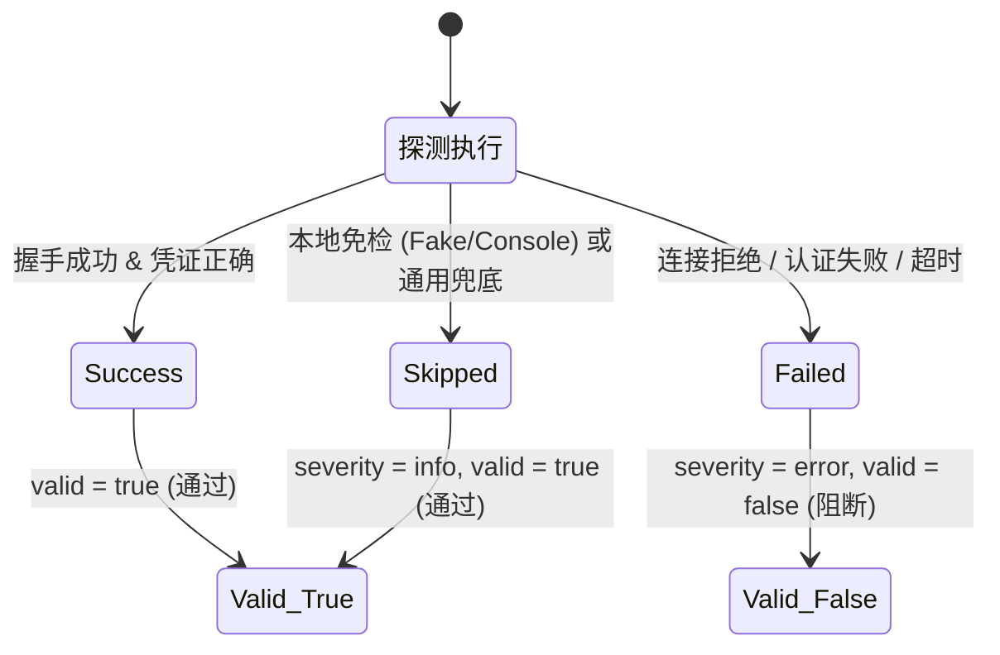

# PRD: 基于 SeaTunnel SPI 与集群拓扑感知的全量连接器测试连接体系

## 1. 背景与业务痛点

在 STX 数据同步 Studio 中，【测试连接】是作业提交和运行前保障质量的核心卡点。然而当前实现存在两大严重的架构与体验缺陷：

1. **引擎契约与连接器割裂（硬编码 JDBC，忽略 80+ 连接器生态与 CDC）**：
   - 现存 `ConfigValidationService` 仅通过硬编码 `if (!"Jdbc".equalsIgnoreCase(pluginName))` 来使用原生 JDBC 直连，将 `MySQL-CDC`、`Kafka`、`Elasticsearch`、`StarRocks` 等大量主流连接器直接打上 `skipped` 标签；
   - 尽管 SeaTunnel v3.0.0 源码中已有 40+ 连接器实现了 `CatalogFactory` SPI（如 ClickHouse, Doris, Mongo, S3, Hive, 以及 17 种 JDBC 变种）和官方 DryRun SPI，但 STX 均未有效复用。

2. **网络拓扑不一致假象（Web 管控平台 vs 真实计算集群网络分区）**：
   - 当前测试连接请求通常由 STX 本地 Proxy 执行。在实际生产部署中，STX 管控节点与客户的数据源可能根本不在同一个 VPC，而只有 SeaTunnel 引擎计算节点所在的网络才能直连目标库；
   - 造成“Web 端测不通但集群能跑通”，或“Web 端测通了但集群因安全组未打通导致任务上线即挂”。

3. **三态契约混乱（将平台未实现当成用户配置错误）**：
   - 之前只要一个节点返回 `skipped`，就被赋予 `severity: warning`，导致整体 `valid: false`。用户填写了正确的配置，却得到一个醒目的红色/黄色未通过弹窗，造成极大困惑。

---

## 2. 目标与价值

- **全量连接器覆盖**：通过 SeaTunnel 官方 SPI（`SupportDryRunValidation`、`CatalogFactory`）以及协议层通用探针，实现 **80+ 连接器的全覆盖探测体系**。
- **真实集群拓扑感知**：测试连接可分发至任务指定的 **目标 SeaTunnel 集群节点（Agent）** 执行，以计算节点的真实内网视角探测，消除网络隔离假象。
- **CDC 深度适配**：对标 SeaTunnel 源码 `CatalogTableUtil` 规范，将 `*-CDC` 映射到底层数据库的 Catalog 或轻量握手通道，覆盖控制信道与基础权限。
- **健壮的三态判定**：确立清晰的 `Success` / `Failed` / `Skipped (Info)` 三态体系，严禁因平台未覆盖专用探针而误将用户合法配置判定为失败。

---

## 3. 详细功能需求

### 3.1 核心探测机制分层 (SeaTunnel SPI 驱动)

| 探测层级 | 机制与源码契约 | 适用连接器范围 | 预期验证深度 |
| :--- | :--- | :--- | :--- |
| **Tier 1: 官方 DryRun SPI** | `SupportSourceDryRunValidation` `SupportSinkDryRunValidation` | `Kafka`, `Jdbc`, `S3File`, `FakeSource` 等实现该接口的 Factory | 凭证校验、Topic 元数据、Bucket 可达性、JDBC 连接 |
| **Tier 2: 官方 Catalog SPI** | `CatalogFactory.createCatalog()` -> `catalog.open()` | 40+ 种连接器： • **关系/分析型**：MySQL, Postgres, Oracle, SQLServer, ClickHouse, Doris, StarRocks, Databend, DB2, 达梦, 人大金仓, OpenGauss, TiDB 等 • **数据湖/存储**：Iceberg, Hudi, Paimon, Kudu, MaxCompute, OSS, HDFS, GCS, S3 • **检索/NoSQL**：Elasticsearch, Easysearch, MongoDB, Milvus, Typesense | 网络握手、账号鉴权、数据库是否存在、表是否存在 |
| **Tier 3: CDC 官方映射探测** | 遵循 `CatalogTableUtil.getCatalogTables` 约定，剥离 `-CDC` 路由至底层数据库 Catalog（如 `MySQL-CDC` -> `MySqlCatalog`） | `MySQL-CDC`, `Postgres-CDC`, `Oracle-CDC`, `SqlServer-CDC`, `TiDB-CDC`, `Vitess-CDC` | 验证管理信道连通性与账号权限 |
| **Tier 4: 专用协议与 TCP 兜底探针** | • Redis: `PING` 命令 • HTTP 族: 轻量 HEAD/GET 请求 • 兜底: Generic TCP 端口 3 次握手 | 未实现 Catalog 或 DryRun 的外部连接器 | 快速确认内网路由、端口监听与防火墙打通情况 |
| **Tier 5: 本地白名单免检** | `FakeSource`, `Console`, `Assert`, `LocalFile` 等 | 本地伪数据/控制台连接器 | 直接标记为 `skipped (severity: info)`，不执行任何外部网络动作 |

---

### 3.2 分布式集群拓扑路由

- **请求上下文**：前端发起测试连接时，携带当前任务绑定的 `cluster_id` 和可选指定的 `node_id` / `host_id`；
- **分发执行**：
  - 若已绑定集群：后端通过 STX Agent（gRPC 信道）将探测报文转发给集群内活跃的 Worker/Master 节点执行；
  - 若未指定集群（草稿编辑态）：由部署在管控服务器本地的 `stx-java-proxy` 兜底执行；
- **结果披露**：
  - 响应报文中明确标明探测来源：`probed_by: { node_id: 1, node_name: "node-worker-01", host_ip: "10.0.0.211" }`；
  - 前端弹窗清晰展示：“探测节点：node-worker-01 (10.0.0.211)”，让运维与开发直观获知网络拓扑视角。

---

### 3.3 结果契约与三态健康模型

1. **Success（成功）**：明确建立物理连接，状态显示绿色勾选，提示 `Connection succeeded.`。
2. **Failed（确凿失败）**：发生网络拒绝、认证异常、密码错误或目标库不存在。显示红色失败，**仅此时将整体标为 `valid: false`**。
3. **Skipped（免检或平台未覆盖协议级探针）**：
   - `severity` 必须为 `info`；
   - **严禁扣除整体验证的 `valid` 判定（`valid` 仍为 `true`）**；
   - 提示文案客观中立：“该连接器无需外部连接”或“已完成 TCP 端口基础打通探测”。

---

## 4. 非功能性需求与规范约束

1. **探测延迟控制**：单节点探测超时严格限制为 3000ms（连接超时 2500ms），总探测时间不超过 5000ms，避免 WebUI 卡顿。
2. **敏感信息脱敏**：探测失败返回的错误堆栈中，URL 密码、JDBC 参数必须严格遵循 STX 安全脱敏规范（不可外泄明文密码）。
3. **资源泄漏防御**：所有 `Catalog.open()`、`DriverManager.getConnection()`、`AdminClient` 必须在 `finally` 块中严格执行 `close()` 或利用 Try-with-resources，防止连接池泄漏。
4. **CLI 一致性保障**：扩展 `stx sync task validate` 命令，支持 `--test-connection` 参数输出结构化多节点探测状态。
