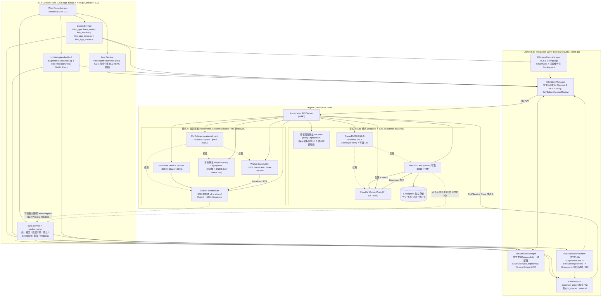
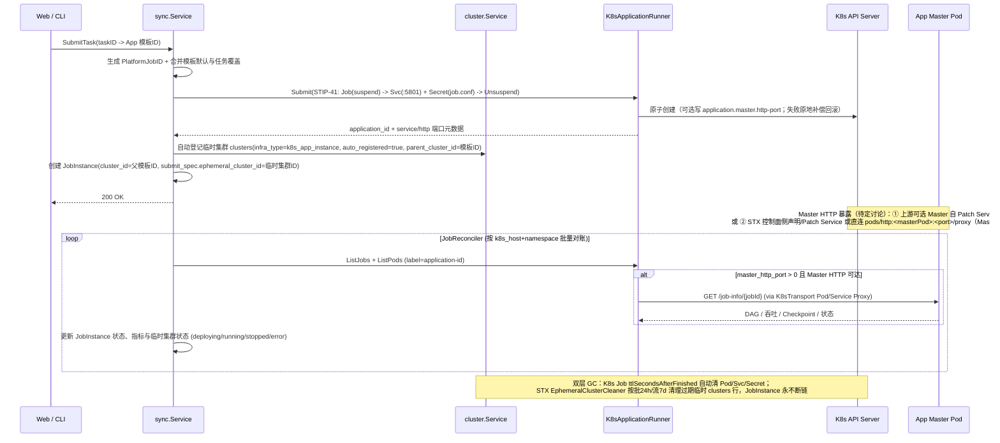

# STX Kubernetes 模式集成 — 完整架构与契约设计

> 状态：Approved Draft（全 4 项决策已收敛，覆盖 P1/P2/P3 全量契约防返工）
> 关联 PRD：[prd.md](./prd.md)
> 关联调研：[research/seatunnel-k8s-and-stx-gaps.md](./research/seatunnel-k8s-and-stx-gaps.md)
> 执行计划：[implement.md](./implement.md)

---

## 1. 总体架构图



---

## 2. 一次性锁定的数据模型与表结构契约（P1 落地即兼容 P2/P3，零返工）

### 2.1 数据库模型扩展

| 表 / 模型 | 新增列或字段语义 | 索引 / 默认值 | 兼容与安全契约 |
| --- | --- | --- | --- |
| `hosts` (`host.Host`) | `k8s_auth_mode` (`kubeconfig` \| `token` \| `in_cluster`)；`k8s_ca_cert` (text, 可选)；`k8s_insecure_skip_tls` (bool)；复用已有 `k8s_api_url` / `k8s_namespace` / `k8s_kubeconfig` / `k8s_token` / `k8s_version` | `k8s_auth_mode` 默认 `kubeconfig` | `k8s_kubeconfig` 与 `k8s_token` 统一走 `internal/utils/secretbox`（AES-256-GCM，密钥派生自 `app.session_secret`）加密落库；`HostInfo` 永不返回明文，仅返回 `has_k8s_kubeconfig` / `has_k8s_token`；更新传空字符串保留原值（跨层指南错误九） |
| `clusters` (`cluster.Cluster`) | `infra_type`（`size:64`，归属公共层不反向依赖 `pkg/k8s`：`bare_metal` \| `kubernetes_session` \| `kubernetes_application_template` \| `kubernetes_application_instance`，并预留未来 `yarn_session` / `yarn_application_*`）；<br>`k8s_host_id` (`*uint`，未来可泛化或与 `config["yarn"]` 并行)；<br>`auto_registered` (`bool`)；<br>`parent_cluster_id` (`*uint`)；<br>`source_job_instance_id` (`*uint`) | `infra_type` 默认 `bare_metal` + index（`size:64` 避免 MySQL/PG 截断）；`k8s_host_id` / `parent_cluster_id` / `auto_registered` 建索引 | 存量行自动为 `bare_metal`、`auto_registered=false`；工作台选择器、`/clusters` 列表、告警评估器全部按 `infra_type` 显式路由 |
| `sync_tasks` (`sync.Task`) | 不新增列；`definition["k8s_application"]` 存 App 任务级覆盖（`worker_count`、`worker_slots`、`master_cpu_cores`、`master_memory_mb`、`worker_cpu_cores`、`worker_memory_mb`、`image`、`active_deadline_seconds`、`node_selector`、`tolerations`、`env`、`secret_ref`） | — | 校验限制 `task.cluster_id` 禁止指向 `kubernetes_application_instance`；覆盖参数自动跟随 `TaskVersion` 快照发布 |
| `sync_job_instances` (`sync.JobInstance`) | 不新增列；**`cluster_id` 始终锚定父 App 模板 ID**；`submit_spec` 持久化：`execution_backend` (`k8s_session` \| `k8s_application`)、`ephemeral_cluster_id`、`k8s_host_id`、`k8s_namespace`、`k8s_application_id`、`k8s_service_name`、`k8s_master_port`、`k8s_master_http_port`（`>0` 表示通过 `application.master.http-port` 发布 HTTP Service 端口）、`restore_from_engine_job_id` | 沿用现有索引 | 满足跨层指南「错误六」；临时集群清理后 `sync_job_instances` 与大盘统计、作业列表筛选、告警记录零断链 |

### 2.2 统一 `Cluster.Config["kubernetes"]` 契约

#### A. 常驻容器集群（`kubernetes_session`，同时涵盖 `adopted` 与 `stx_deployed`）
```json
{
  "host_id": 12,
  "namespace": "seatunnel",
  "management_source": "adopted",
  "access_mode": "apiserver_proxy",
  "external_base_url": "",
  "stx_callback_url": "",
  "image": "apache/seatunnel:3.1.0",
  "image_pull_policy": "IfNotPresent",
  "image_pull_secrets": [],
  "service_account": "seatunnel",
  "master_workload_kind": "StatefulSet",
  "master_workload_name": "seatunnel-master",
  "master_replicas": 1,
  "worker_workload_kind": "StatefulSet",
  "worker_workload_name": "seatunnel-worker",
  "worker_replicas": 2,
  "master_service_name": "seatunnel-master",
  "cluster_service_name": "seatunnel",
  "master_http_port": 8080,
  "hazelcast_port": 5801,
  "metrics_port": 8080,
  "metrics_path": "/metrics",
  "configmap_name": "seatunnel-configs",
  "label_selector": "app.kubernetes.io/instance=seatunnel",
  "resources": {
    "master": { "cpu": "1", "memory": "2Gi" },
    "worker": { "cpu": "2", "memory": "4Gi" }
  },
  "storage": {
    "checkpoint_pvc": "",
    "data_storage_class": "",
    "data_size": "10Gi"
  },
  "extra_mounts": [
    {
      "kind": "configmap",
      "name": "hadoop-conf",
      "mount_path": "/etc/hadoop/conf",
      "env_vars": { "HADOOP_CONF_DIR": "/etc/hadoop/conf" }
    }
  ],
  "java_proxy": {
    "mode": "managed",
    "reuse_cluster_id": 0,
    "deployment_name": "stx-java-proxy-seatunnel",
    "service_name": "stx-java-proxy-seatunnel",
    "port": 18080,
    "jvm_opts": "-Xms64m -Xmx512m",
    "external_url": ""
  }
}
```

#### B. App 模板（`kubernetes_application_template`）
```json
{
  "host_id": 12,
  "namespace": "seatunnel-apps",
  "access_mode": "apiserver_proxy",
  "stx_callback_url": "",
  "image": "apache/seatunnel:3.1.0",
  "image_pull_policy": "IfNotPresent",
  "image_pull_secrets": [],
  "service_account": "seatunnel-application",
  "seatunnel_home": "/opt/seatunnel",
  "runtime_config": {
    "mode": "image_default",
    "configmap_name": "",
    "mounts": {
      "seatunnel.yaml": "/opt/seatunnel/config/seatunnel.yaml"
    },
    "env_secrets": {}
  },
  "master_port": 5801,
  "master_http_port": 8080,
  "checkpoint_pvc": "",
  "finished_job_retention_seconds": 86400,
  "ephemeral_cluster_retention": {
    "batch_hours": 24,
    "streaming_hours": 168
  },
  "defaults": {
    "worker_count": 2,
    "worker_slots": 2,
    "master_cpu_cores": 1,
    "master_memory_mb": 1024,
    "worker_cpu_cores": 2,
    "worker_memory_mb": 2048,
    "startup_timeout_millis": 180000
  },
  "java_proxy": {
    "mode": "managed",
    "reuse_cluster_id": 0,
    "deployment_name": "stx-java-proxy-apppool",
    "service_name": "stx-java-proxy-apppool",
    "port": 18080,
    "jvm_opts": "-Xms64m -Xmx512m",
    "external_url": ""
  }
}
```

---

## 3. 常驻容器「纳管 (`adopted`) + 一键部署 (`stx_deployed`)」统一设计

为避免先做纳管、后补部署返工，两种来源在 Phase 1 共用完全一致的 K8s 资源契约与状态投影，仅在**创建与删除/卸载边界**区分 `management_source`：

### 3.1 STX 一键部署标准资源清单（对齐上游生产推荐）
当 `management_source == "stx_deployed"` 时，STX 按确定性命名 `<cluster_code>-*` 与统一标签（`app.kubernetes.io/managed-by: stx`, `stx.seatunnel.apache.org/cluster-id: <id>`, `stx.seatunnel.apache.org/cluster-code: <code >`, `app.kubernetes.io/component: master|worker`）顺序创建：
1. **RBAC（可选开关，默认按需创建）**：ServiceAccount + Role/RoleBinding（仅允许 Hazelcast K8s 发现所需的 `get/list` endpoints/pods，若用户指定已有 ServiceAccount 则跳过创建）；
2. **ConfigMap（`<code >-configs`）**：渲染 `seatunnel.yaml`（`http.enable-http: true, port: 8080`、`telemetry.metric.enabled: true`、checkpoint 存储）、`hazelcast-master.yaml` / `hazelcast-worker.yaml`（`join.kubernetes.enabled: true`, `service-dns: <code>.<ns>.svc.cluster.local:5801`, `rest-api.enabled: false`）、`hazelcast-client.yaml`、`jvm_master_options`、`jvm_worker_options`、`log4j2.properties`；
3. **Headless Services**：`<code>`（5801，Hazelcast 发现）、`<code>-master`（8080，Master REST/WebUI）；
4. **Master `StatefulSet`（`<code>-master`）** & **Worker `StatefulSet`（`<code>-worker`）**：
   - `command` 直接执行 `["/opt/seatunnel/bin/seatunnel-cluster.sh", "-r", "master|worker"]`（不套 `/bin/sh -c`，确保 JVM 为 PID 1 正常接收 SIGTERM）；
   - `terminationGracePeriodSeconds: 120`；
   - `startupProbe` / `readinessProbe` / `livenessProbe`（Master 探 `5801` + readiness 可选探 `8080/overview`；Worker 探 `5801`）；
   - 挂载 `<code>-configs` ConfigMap（以及可选 Checkpoint PVC）；
5. **常驻伴生 `stx-java-proxy` Deployment + Service**（见第 4 节）。

### 3.2 生命周期、滚动镜像升级与卸载安全边界
- **扩缩容**：`Scale` API 调整 `master`/`worker` StatefulSet/Deployment replicas（支持停止=记录原副本数并缩至 0，启动=恢复原副本数）。
- **不可变镜像升级（替代物理机包升级与动态装插件）**：提供「更新镜像 / 滚动升级」操作——同时 Patch Master/Worker StatefulSet 的容器 `image` 与伴生 `stx-java-proxy` Deployment 的 `image`，K8s 原生执行 RollingUpdate，升级完成后伴生 Proxy 自动加载新镜像内全部连接器。
- **删除/卸载边界（防误删生产集群！）**：
  - `adopted`（纳管集群）：删除 STX 集群记录时**绝不删除用户原有的 SeaTunnel StatefulSet/ConfigMap/Service**，仅清理 STX 自己创建的伴生 `stx-java-proxy`（Deployment/Service/ConfigMap）；
  - `stx_deployed`（STX 一键部署集群）：删除弹窗提供显式勾选「同时删除 STX 创建的 K8s 资源（StatefulSet/Service/ConfigMap/伴生 Proxy）」，**永不删除用户外部 PVC（如 Checkpoint PVC）**。

---

## 4. 伴生 `stx-java-proxy`、App 临时集群生命周期与无 Agent 替代设计

### 4.1 伴生 `stx-java-proxy`（272 KB ConfigMap `binaryData` + 保存即常驻探活）

- **两步职责清晰分离**：
  - **测试连接**：纯只读校验（API Server `/version`、Namespace/SA 存在、`SelfSubjectAccessReview` 检查 Deployments/StatefulSets/Jobs/Pods/Services/ConfigMaps/Secrets/`pods/proxy`/`pods/log` 权限），**不向 K8s 写入任何对象**。
  - **保存 / 注册集群或 App 模板**：默认自动将 STX 本地 `lib/stx-java-proxy-v{2,3}.jar`（约 272 KB，带 SHA256 annotation）写入目标 Namespace `ConfigMap.binaryData["stx-java-proxy.jar"]`，并拉起 1 副本常驻伴生 `Deployment` + `Service(:18080)`，随后通过 `K8sTransport` 探活 `/healthz`；失败不阻断保存但明确标红展示 Pod Events 并支持一键重试。
- **连接器 JAR 与驱动自动对齐**：
  - **常驻集群**：自动克隆目标 Master/Worker Workload 的 `image`、`imagePullSecrets`、`env`/`envFrom`，以及挂载到 `/opt/seatunnel/{connectors,plugins,lib,config}` 与 Checkpoint 的 `ConfigMap`、`Secret`、`RWX/ROX PVC` 与插件 `initContainers + emptyDir`，**显式跳过 StatefulSet 的 `RWO` 单 Pod 数据 PVC**。
  - **App 模板**：直接使用模板指定的 `image`、`imagePullSecrets`、`runtime_config`（托管或引用 ConfigMap）、`checkpoint_pvc`；从该模板启动的所有临时 App 实例均通过 `parent_cluster_id` 共享此常驻 Proxy。P2 同时在伴生 Proxy 增加只读接口 `GET /api/v1/config/defaults`，直接读取目标容器镜像内真实的 `$SEATUNNEL_HOME/config/*` 作为配置编辑基线（借鉴 StreamPark `FlinkEnv` 同步基线，兼容任意版本与企业定制镜像）。
  - 支持 `managed`（默认）、`reuse_cluster`（同 Host/Namespace 多模板共享省内存）、`external` / `disabled`。
- **插件页定位（不可变镜像原则）**：
  - 对所有 K8s 集群（Session / App 模板 / App 实例），隐藏物理机「上传/安装/卸载插件」写按钮；
  - 展示当前镜像 Tag + 伴生 Proxy `/api/v1/plugin/list` 返回的**只读已内置连接器清单**，引导通过“更新镜像 Tag 滚动升级”变更连接器与 JDBC 驱动。

### 4.2 App 模式临时集群生命周期（STIP-41 纯 Go + 自动登记 + 视图隔离 + 定期清理）



- **4 条防污染硬边界**：
  1. **`/clusters` 列表页视图隔离**：默认视图只展示「受管集群与模板」（`bare_metal` + `kubernetes_session` + `kubernetes_application_template`）；独立分段「App 运行实例」默认优先展示运行中/实时任务，支持一键清理过期临时记录与残留 K8s Job。
  2. **工作台目标集群选择器隔离**：严格排除 `auto_registered=true` 的临时实例。
  3. **外键不断链契约**：`sync_tasks.cluster_id` 与 `sync_job_instances.cluster_id` 永远指向父 App 模板 ID；临时集群定期清理不影响任何历史作业、趋势图或告警记录。
  4. **告警与大盘隔离**：App 模板不评估 `master_unavailable`/`worker_insufficient`；批任务与已终态 App 实例不触发集群可用性告警且不计入首页集群故障率。
- **App 模板运行时配置三选一（兼顾零配置与 GitOps，复用 `subPath` 仅覆盖改动文件）**：
  1. `image_default`（默认，零配置）：不挂载额外 ConfigMap，直接使用镜像内置 `/opt/seatunnel/config/*`；
  2. `stx_managed`（STX 托管，推荐）：经伴生 Proxy 拉取镜像默认文件为基线，在 STX 内编辑 `seatunnel.yaml` / `jvm_options` / `log4j2.properties`（支持 `${VAR}` + `secretKeyRef` 零明文），保存模板时 STX 在目标 Namespace 自动同步专属 ConfigMap（`stx-app-cfg-<code>`），提交时仅对已修改文件按 `subPath` 挂载（不遮蔽镜像其余默认文件）；单作业特殊覆写支持生成带 `OwnerReference -> Job` 的临时 ConfigMap，作业结束自动 GC；
  3. `external_ref`（引用外部 ConfigMap）：面向 Helm/GitOps 团队，STX 仅做提交前存在性/key 校验与只读预览，绝不篡改外部对象。
- **平台无关扩展口子（为未来 YARN 预留）**：
  - `sync` 层在 P2 抽象统一 `ApplicationBackend` 接口（`Submit` / `ReconcileBatch` / `Cancel` / `StopWithSavepoint` / `GetLogs` / `GetEvents` / `Cleanup`），K8s 实现为 `K8sApplicationBackend`；未来接入 YARN 时只需新增 `YarnApplicationBackend` 注册实现，主提交流程与 `JobReconciler` 无需重写。
- **Open Discussion · App 模式 Master HTTP Service 发布归属（待 P2 启动前拍板）**：
  - **方案 1（上游 `LeonYoah/seatunnel#6` Master 自 Patch）**：Master Pod 绑定 Jetty 后自行 Patch Headless Service 追加 `http` 端口；**风险**：需要额外授予工作负载 Master SA `services: patch` RBAC，可能不符合上游最小权限与职责分离规范、未必会被 SeaTunnel 主干合并。
  - **方案 2（第三方控制面 STX 侧承接，推荐默认）**：Master Pod SA 保持最小权限（**不需要 `services: patch`**），HTTP 端口访问由 STX 控制面负责——① 对账/观测/WebUI/Savepoint 默认优先走 `K8sTransport.PodBaseURL`（`/api/v1/namespaces/{ns}/pods/http:<masterPod>:<port>/proxy/...`，零 Service 依赖，即使未发布 HTTP Service 也能用）；② 若外部需要通过 Service 访问，由拥有控制面权限的 STX 侧统一创建或 Patch OwnerRef Service（而非让 Master Pod 自己 Patch）。两套方案可平滑兼容，互不阻塞。

### 4.3 无 `stx agent` 替代边界（P3 补齐诊断增强）
- **P1 完整替代**：进程拉活（Kubelet）、扩缩容与滚动重启（Scale/Rollout）、配置读写（ConfigMap）、引擎探活与成员探测（`K8sTransport` + `/overview` 双校验）、作业与节点日志（`PodLogs`）、伴生 `stx-java-proxy`、8080 `/metrics` 采集（支持自定义端口/路径）、Web UI 代理（按 Master Pod 探测 Active Master）。
- **P3 诊断/观测增强**：控制面 `K8sErrorLogCollector`（按 `SinceTime` 增量拉取受管 Pod Logs 写入诊断中心错误组）、`pods/exec` JVM Thread Dump（`jcmd 1 Thread.print`）、可选 `metrics-server` Pod CPU/Mem 指标采集（未安装自动降级不报错）。
- **明确边界**：不支持宿主机磁盘 IOPS/网卡吞吐、不支持容器内 `jmap` Heap Dump、K8s 集群隐藏工作台 `local` 执行模式。

---

## 5. API 与 CLI 契约总览（同步遵循 `AGENTS.md` CLI 约定）

| 阶段 | HTTP API | 对应 `stx` CLI 命令 |
| --- | --- | --- |
| **P1 · Host** | `POST/PUT /api/v1/hosts`（完善 `kubernetes` 加密/脱敏）、`POST /api/v1/hosts/:id/test-connection`、`GET /api/v1/hosts/:id/k8s/namespaces`、`GET /api/v1/hosts/:id/k8s/discover` | `stx host create/update --host-type kubernetes ...`、`stx host test <id>`、`stx host k8s discover <id> [--namespace ...]` |
| **P1 · Session** | `POST /api/v1/clusters`（支持 `infra_type=kubernetes_session` 纳管/一键部署）、`POST /api/v1/clusters/:id/k8s/scale`、`POST /api/v1/clusters/:id/k8s/rollout-restart`、`POST /api/v1/clusters/:id/k8s/upgrade-image`；复用现有 `nodes`/`logs`/`config`/`webui-endpoints`/`stx-java-proxy/*` | `stx cluster create --infra-type kubernetes_session ...`、`stx cluster k8s scale <id> --role worker --replicas N`、`stx cluster k8s rollout-restart <id>`、`stx cluster k8s upgrade-image <id> --image ...` |
| **P2 · App** | `POST /api/v1/clusters`（`infra_type=kubernetes_application_template`）、`GET /api/v1/clusters?scope=managed\|app_instances`、`GET /api/v1/clusters/:id/k8s/applications`、`POST /api/v1/clusters/k8s/ephemeral/cleanup`、`GET /api/v1/sync/jobs/:id/k8s-events`；复用 `sync` 提交/停止/恢复/日志/WebUI | `stx cluster create --infra-type kubernetes_application_template ...`、`stx cluster list --scope app_instances`、`stx cluster k8s cleanup-ephemeral [--template-id ...]`、`stx sync job k8s-events <id>` |
| **P3 · Diag** | 复用 `/api/v1/diagnostics/errors`、`/api/v1/diagnostics/tasks`（支持 K8s Pod Thread Dump）与 `/api/v1/monitoring/*` | 复用既有 `stx diagnostics` / `stx monitoring` 命令 |

---

## 6. 兼容性、回滚与风险控制

- **数据库迁移**：所有新增列均为可空或带安全默认值（`infra_type='bare_metal'`、`auto_registered=false`、`k8s_auth_mode='kubeconfig'`），兼容 SQLite / MySQL / PostgreSQL，支持无停机回滚。
- **凭据安全**：历史若存在明文 `k8s_kubeconfig`/`k8s_token`，读取时兼容明文并在下次保存时自动升级为密文（带 `enc:v1:` 前缀区分）。
- **云端安全实测原则**：在云端 Minikube 实测一键部署和 App 模式时，新建独立测试 Namespace（如 `seatunnel-stx-e2e`、`seatunnel-apps`），保留现有 `seatunnel` Namespace 用于验证“纳管已有集群”。
