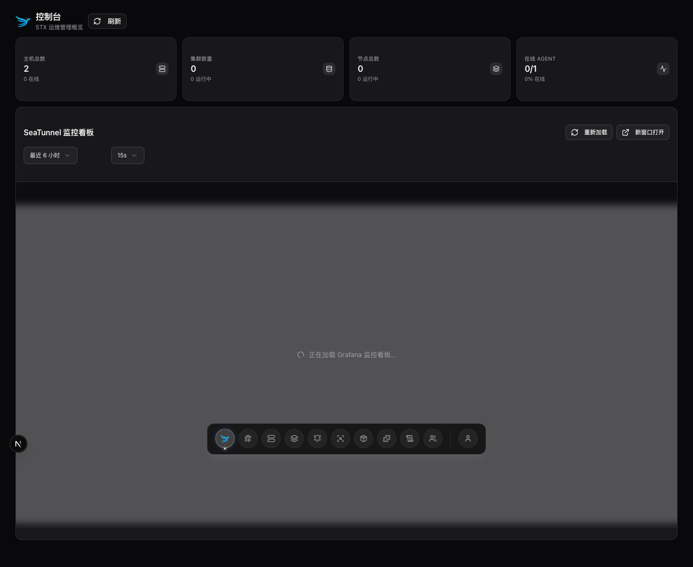
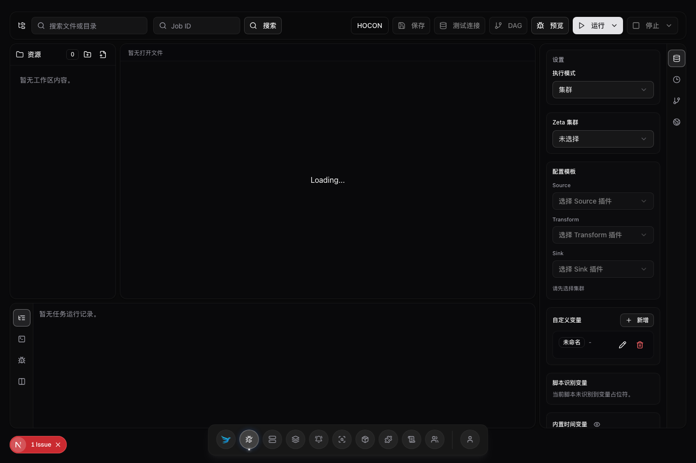
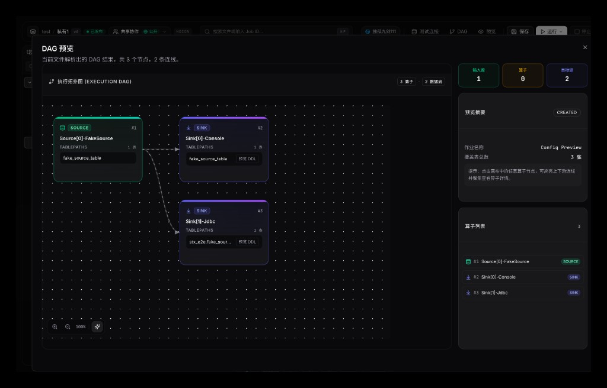
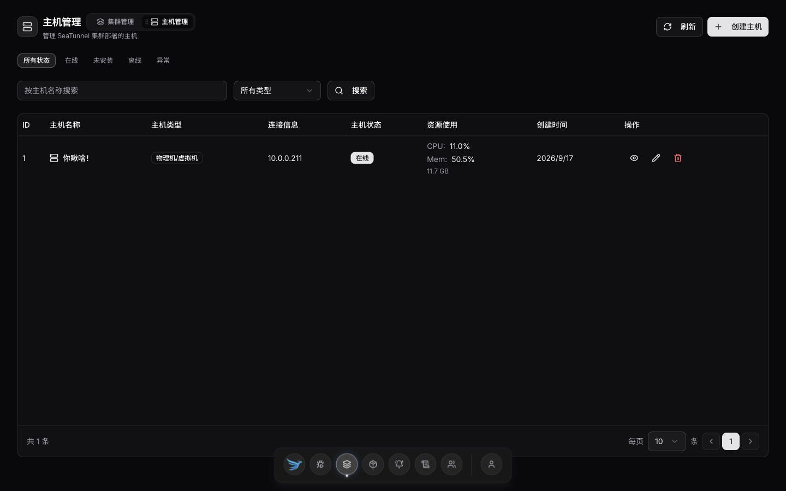
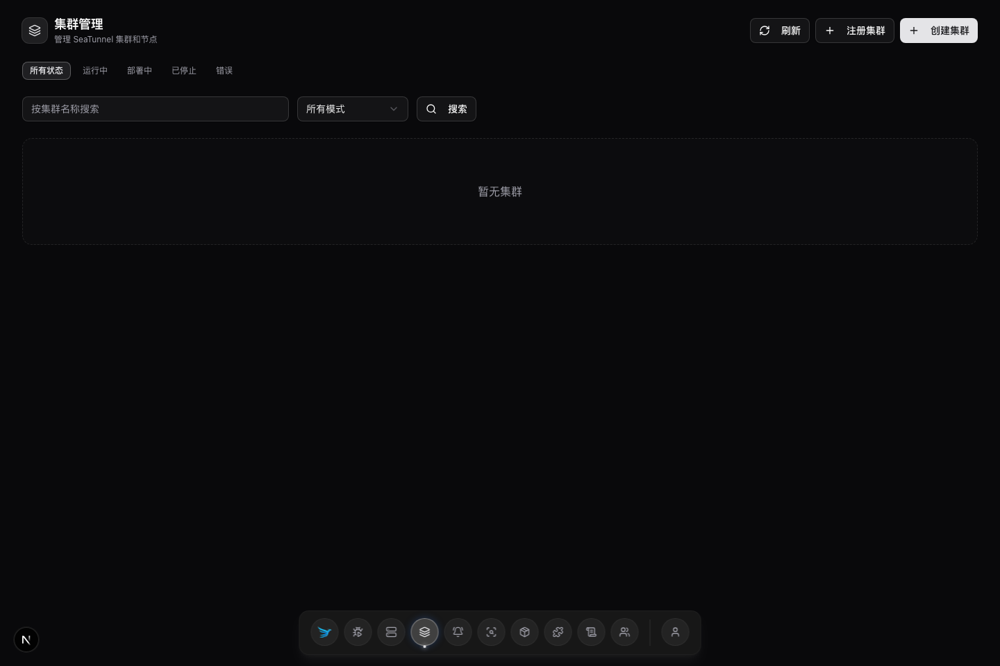
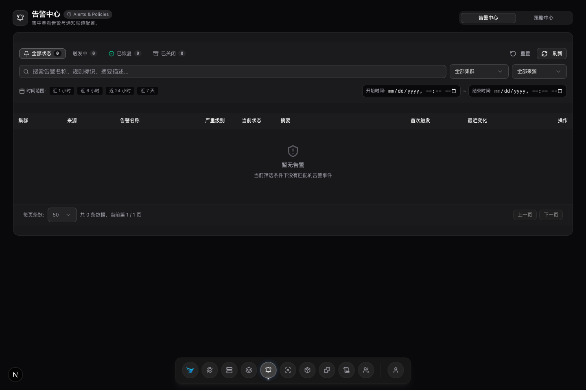
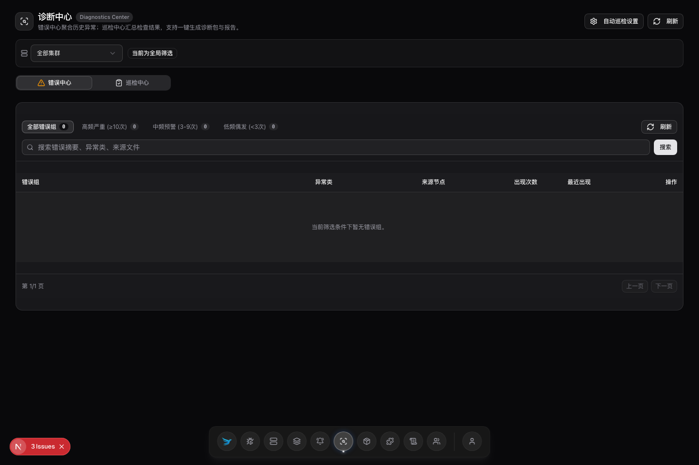
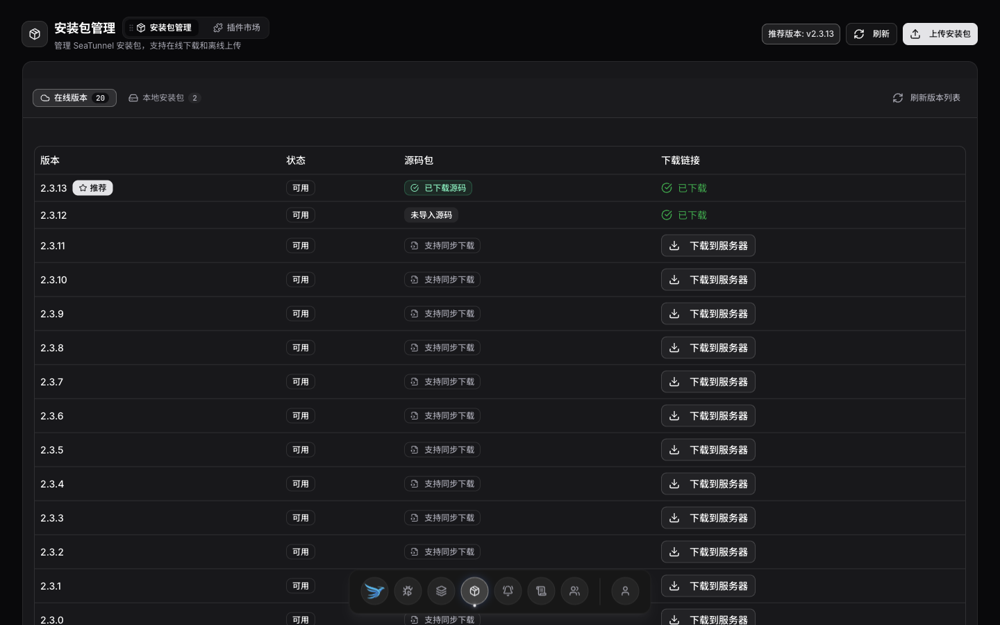
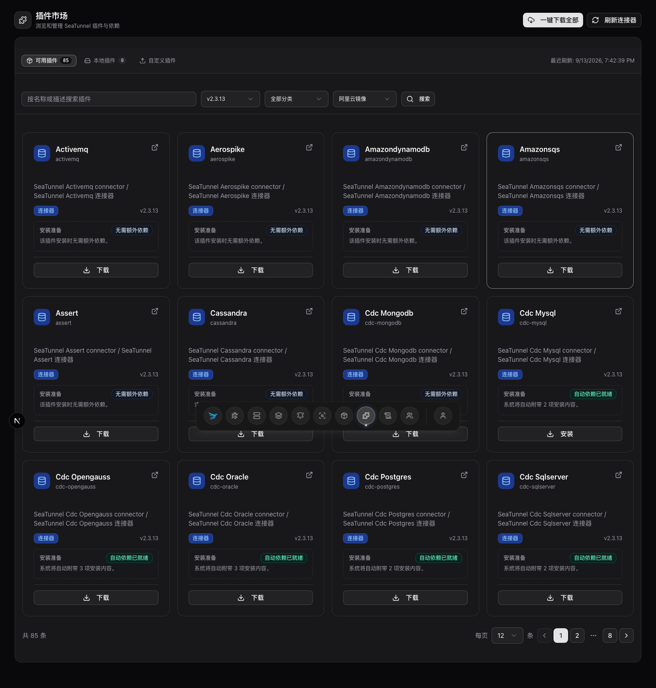
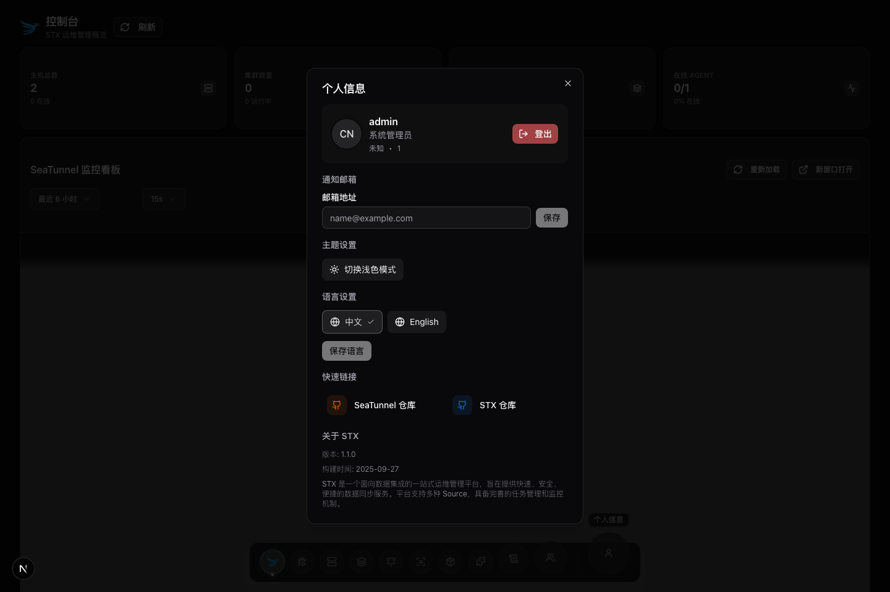

# STX

**One-stop SeaTunnel ops platform** — make SeaTunnel ops no longer a black box.

[中文文档](./README_CN.md) · [Secondary development](./docs/secondary-development.md) · [Quick start (CN)](./docs/00-快速开始.md)

## Why STX

Running SeaTunnel in production is rarely “just submit a job”. Teams also need host monitoring, cluster restart, install and upgrade, connector distribution, config changes, runtime diagnosis, Checkpoint inspection, and recovery after job failures.

STX is the control plane for that work: one place to manage hosts, clusters, packages, plugins, monitoring, diagnostics, and job operations — with a native AI Agent ops entry (CLI + Skill).

## Highlights

- **Host & Agent** — host onboarding, Agent install, heartbeat and capacity
- **Cluster lifecycle** — create, deploy, start/stop, and upgrade SeaTunnel clusters
- **Packages & plugins** — package management and connector marketplace installs
- **Observability & diagnosis** — monitoring center, inspections, error clues, recovery actions
- **Job workbench** — HOCON/DAG workflows, Checkpoint visualization, debuggable runs
- **AI Agent entry** — CLI + Skill oriented intelligent ops entry (in progress)
- **Auth & audit** — password login, optional GitHub/Google OAuth, audit logs, user admin

## Screenshots

| Page | Preview |
| --- | --- |
| Login |  |
| Dashboard |  |
| Workbench |  |
| DAG |  |
| Hosts |  |
| Clusters |  |
| Monitoring |  |
| Diagnostics |  |
| Packages |  |
| Plugins |  |
| User Center |  |

## Architecture

```
┌─────────────────┐     ┌─────────────────┐     ┌─────────────────┐
│  Frontend       │     │  Backend        │     │  Database       │
│  Next.js        │◄───►│  Go (Gin)       │◄───►│  SQLite/MySQL/  │
│  React 19       │     │  GORM + gRPC    │     │  PostgreSQL     │
└─────────────────┘     └────────┬────────┘     └─────────────────┘
                                 │
                                 ▼
                        ┌─────────────────┐
                        │  STX Agent      │
                        │  on each host   │
                        └─────────────────┘
```

## Supported platforms

One-click control-plane install targets **Linux** on **amd64 / arm64**.

| Distro | amd64 | arm64 | Notes |
| --- | --- | --- | --- |
| Ubuntu / Debian | Yes | Yes | Preferred; skip Node download if local Node ≥ 18.18 |
| Rocky / Alma / CentOS Stream / RHEL 8+ | Yes | Yes | Official Node 22 |
| CentOS 7 (glibc 2.17) | Yes | **No** | amd64 only via `node-18-glibc217`. No arm64 glibc217 Node build |
| Other systemd Linux | Usually | Usually | Needs glibc ≥ 2.17; glibc &lt; 2.28 uses the centos7 bundle |

macOS / Windows are for local development, not the one-click installer. Default ports: API **17800**, frontend **17880**, gRPC **17890**.

## Quick start

### Requirements (local development)

- Go >= 1.26.10
- Node.js >= 18
- pnpm >= 8 (recommended)

### Run locally

```bash
git clone https://github.com/LeonYoah/stx.git
cd stx
cp config.example.yaml config.yaml

go mod tidy
go run main.go api
```

In another terminal:

```bash
cd frontend
pnpm install
pnpm dev
```

Open `http://localhost:3000` and sign in with `admin` / `admin123` (or the values in `config.yaml`).

### Online install (recommended)

One command: picks the offline bundle for this CPU / glibc, downloads it over the fastest line, verifies sha256 and installs it.

```bash
# China (recommended, gh-proxy v4 line)
curl -fsSL https://v4.gh-proxy.org/https://github.com/LeonYoah/stx/releases/latest/download/install-online.sh | sudo bash

# Global
curl -fsSL https://github.com/LeonYoah/stx/releases/latest/download/install-online.sh | sudo bash
```

- Download lines: `1) gh-proxy` `2) v4` (recommended) `3) v6` `4) cdn` (Fastly) `5) axisnow` `6) github` (direct); the fastest is picked automatically. Force one with `--mirror v4|2|https://custom-prefix` or `STX_MIRROR=...`.
- Variant: `--variant amd64|arm64|centos7` (default auto: amd64 with glibc < 2.28 → centos7). Pin a version: `bash -s -- --version v1.3.0`.
- Non-interactive (CI / fleets): `curl ... | sudo bash -s -- -y --admin-password 'xxx'`.
- Requirements: `bash`, `curl`, `tar`, `gzip`, `awk`/`sed`/`grep`, `sha256sum` — **no python3**.

### Offline install (whole bundle)

Every Release ships three complete offline bundles (backend, Agent, frontend, Node runtime, observability stack, Java proxy), each with a `.sha256`:

| Bundle | Target OS | Node |
| --- | --- | --- |
| `stx-<ver>-linux-amd64-offline.tar.gz` | x86_64, glibc ≥ 2.28 (Ubuntu 20.04+, Debian 10+, Rocky/Alma/RHEL 8+, openEuler, Kylin V10, ...) | official Node 22 |
| `stx-<ver>-linux-arm64-offline.tar.gz` | aarch64, glibc ≥ 2.28 | official Node 22 |
| `stx-<ver>-linux-amd64-centos7-offline.tar.gz` | x86_64, glibc < 2.28 (**CentOS 7**, RHEL 7) | Node 18 glibc217 |

Not sure which one: `uname -m` (x86_64 / aarch64) and `ldd --version | head -1` (glibc).

`latest` also carries fixed names (`stx-offline-linux-amd64.tar.gz`, `stx-offline-linux-arm64.tar.gz`, `stx-offline-linux-amd64-centos7.tar.gz`) for direct wget. CentOS 7 example (pick whichever line is fastest):

```bash
F=stx-offline-linux-amd64-centos7.tar.gz   # or stx-offline-linux-amd64.tar.gz / stx-offline-linux-arm64.tar.gz
U=https://github.com/LeonYoah/stx/releases/latest/download/$F
wget "https://gh-proxy.org/$U"          # 1) gh-proxy main
wget "https://v4.gh-proxy.org/$U"       # 2) v4 (recommended)
wget "https://v6.gh-proxy.org/$U"       # 3) v6 (IPv6)
wget "https://cdn.gh-proxy.org/$U"      # 4) Fastly CDN
wget "https://axisnow.gh-proxy.org/$U"  # 5) AxisNow
wget "$U"                               # 6) GitHub direct
# fetch $F.sha256 the same way, then:
sha256sum -c "$F.sha256"
tar -xzf "$F" && cd stx-*-offline/
sudo ./install.sh
```

On a connected host you can also let the script probe and download: `curl -fsSL https://github.com/LeonYoah/stx/releases/latest/download/download-bundle.sh | bash` (`--variant centos7`; `--print-urls` only prints the 6 links above).

### Common flags

```bash
sudo ./install.sh                                    # interactive: Enter = default
sudo ./install.sh -y --admin-password 'xxx'          # non-interactive
sudo ./install.sh --db-type mysql    --db-host 10.0.0.5 --db-user stx --db-name stx
sudo ./install.sh --db-type postgres --db-host 10.0.0.5 --db-user stx --db-name stx
sudo ./install.sh --install-dir /data/stx --frontend-port 18880 --http-port 18800 --grpc-port 18890
```

- Database: `sqlite` (default) / `mysql` / `postgres` (`pg`); the database password is prompted, or pass `--db-password` / `STX_DB_PASSWORD` (`sudo STX_DB_PASSWORD='xxx' ./install.sh ...`).
- Run with sudo. Non-root works only with a writable `--install-dir` plus `--no-systemd`.
- Other flags: `--external-ip`, `--without-observability`, `--service-user`, `--no-systemd`, `--no-start`, `--force`; full list: `./install.sh --help`.
- `--mirror`, `--variant`, `--version`, `--bundle-file` belong to `install-online.sh` / `download-bundle.sh` only, not to the offline `install.sh`; `install-online.sh` passes all other flags through (`curl ... | sudo bash -s -- --db-type postgres ...`).

### Manual download (cannot run scripts, assemble by hand)

1. Download helpers: [stx-install-helpers.tar.gz](https://github.com/LeonYoah/stx/releases/latest/download/stx-install-helpers.tar.gz)  
2. Put assets below into `packages/`  
3. `sudo ./install.sh --offline`  

China: paste links into [https://gh-proxy.com/](https://gh-proxy.com/).

| Asset | amd64 | arm64 |
| --- | --- | --- |
| stx | [download](https://github.com/LeonYoah/stx/releases/latest/download/stx-linux-amd64) | [download](https://github.com/LeonYoah/stx/releases/latest/download/stx-linux-arm64) |
| frontend | [download](https://github.com/LeonYoah/stx/releases/latest/download/frontend-standalone-linux-amd64.tar.gz) | [download](https://github.com/LeonYoah/stx/releases/latest/download/frontend-standalone-linux-arm64.tar.gz) |
| stx-agent | [download](https://github.com/LeonYoah/stx/releases/latest/download/stx-agent-linux-amd64) | [download](https://github.com/LeonYoah/stx/releases/latest/download/stx-agent-linux-arm64) |
| observability | [download](https://github.com/LeonYoah/stx/releases/download/deps/observability-prom3.9.1-am0.31.1-gf12.3.3-linux-amd64.tar.gz) | [download](https://github.com/LeonYoah/stx/releases/download/deps/observability-prom3.9.1-am0.31.1-gf12.3.3-linux-arm64.tar.gz) |

```bash
ldd --version | head -1
node -v
```

| Environment | amd64 | arm64 |
| --- | --- | --- |
| glibc &lt; 2.28 (e.g. CentOS 7) | [node-18-glibc217](https://github.com/LeonYoah/stx/releases/download/deps/node-18-glibc217-linux-amd64.tar.gz) | unsupported |
| glibc ≥ 2.28, no Node ≥ 18.18 | [node-22-official](https://github.com/LeonYoah/stx/releases/download/deps/node-22-official-linux-amd64.tar.gz) | [node-22-official](https://github.com/LeonYoah/stx/releases/download/deps/node-22-official-linux-arm64.tar.gz) |
| Node ≥ 18.18 already | skip | skip |

### Docker full stack

Release asset: `stx-docker-compose.tar.gz` (wired in packaging; available on **new tags**, not yet on older `latest` if 404).

```bash
mkdir -p stx-docker && cd stx-docker
curl -fsSL https://github.com/LeonYoah/stx/releases/latest/download/stx-docker-compose.tar.gz | tar -xz
cd docker
cp config.example.yaml config.yaml   # edit database for the compose file you use
docker compose up -d                 # MySQL default
```

China: paste into [gh-proxy.com](https://gh-proxy.com/), or use the `v4.gh-proxy.org/https://github.com/...` URL.

China images (Huawei SWR): set `STX_IMAGE_REGISTRY=swr.cn-east-3.myhuaweicloud.com/stx` in `.env`, or:

```bash
cp .env.cn.example .env
docker compose up -d
```

| DB | Start |
| --- | --- |
| MySQL (default) | `docker compose up -d` |
| SQLite | `docker compose -f docker-compose.sqlite.yml up -d` |
| PostgreSQL | `docker compose -f docker-compose.postgres.yml up -d` |

| Service | URL |
| --- | --- |
| UI | http://127.0.0.1:17880 |
| API | http://127.0.0.1:17800 |
| Grafana | http://127.0.0.1:3000 |
| Prometheus | http://127.0.0.1:9090 |
| Alertmanager | http://127.0.0.1:9093 |

Single container (no monitoring):

```bash
# Global GHCR
docker run -d -p 17800:17800 -p 17880:17880 -p 17890:17890 ghcr.io/leonyoah/stx-all-in-one:latest
# China Huawei SWR
docker run -d -p 17800:17800 -p 17880:17880 -p 17890:17890 swr.cn-east-3.myhuaweicloud.com/stx/stx-all-in-one:latest
```

After binary install: `/opt/stx/bin/start.sh` (default `--observability auto`) or `systemctl restart stx`.  
Optional: `/opt/stx/bin/start.sh --observability off`.

More: [docs/00-快速开始.md](./docs/00-快速开始.md), [docs/打包发布说明.md](./docs/打包发布说明.md), [docs/可观测性三件套一键接入说明.md](./docs/可观测性三件套一键接入说明.md).

## Configuration essentials

| Key | Purpose | Default |
| --- | --- | --- |
| `auth.default_admin_username` | Initial admin username | `admin` |
| `auth.default_admin_password` | Initial admin password | `admin123` |
| `database.type` | Database type | `sqlite` |
| `app.addr` | HTTP listen address | see `config.example.yaml` |
| `grpc.port` | Agent gRPC port | see `config.example.yaml` |

Optional OAuth providers (`github` / `google`) can be enabled under `oauth_providers` in `config.yaml`. Callback URL is typically `http://localhost:3000/callback`.

## Docs

- [Quick start (users)](./docs/00-快速开始.md)
- [Secondary development](./docs/secondary-development.md)
- [Packaging & release](./docs/打包发布说明.md)
- [Observability integration](./docs/可观测性三件套一键接入说明.md)

## License

Apache License 2.0. See [LICENSE](./LICENSE).

This project was originally adapted from [linux-do/cdk](https://github.com/linux-do/cdk) (MIT).

## Links

- [Apache SeaTunnel](https://seatunnel.apache.org/)
- [STX on GitHub](https://github.com/LeonYoah/stx)
